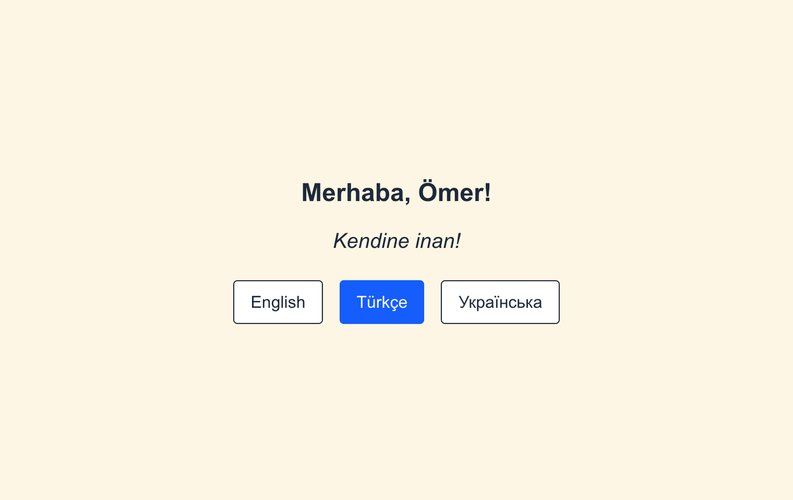

# Multilingual Quote Generator

A small web app that greets you by name and shows a motivational quote in English, Turkish or Ukrainian.

Next.js · Tailwind CSS



Enter your name on the first page and you are taken to a page with a quote and three language buttons. Switching the language changes the quote and the greeting without reloading the page.

## Running it

```bash
git clone https://github.com/omeraydin00/multilingual-quote-generator.git
cd multilingual-quote-generator/multilingual-quote-generator
npm install
npm run dev
```

Then open http://localhost:3000.
